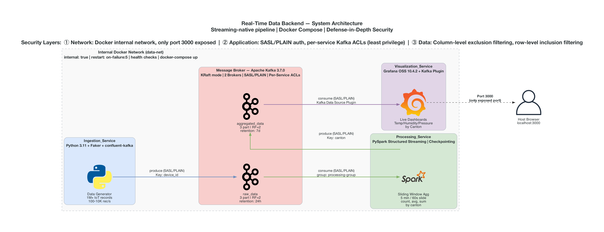
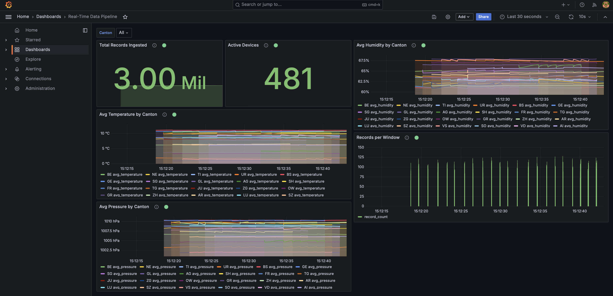

# Real-Time Data Backend

A streaming-native, real-time data pipeline built as four Docker microservices.
The system continuously generates synthetic IoT weather-station telemetry from
Swiss cantons, streams it through an Apache Kafka cluster, processes and
aggregates it with PySpark Structured Streaming, and visualizes the live results
in Grafana dashboards sourced directly from Kafka.

There is no external database and no REST API layer: Kafka serves as both the
transport and the aggregation store, and every consumer reads directly from
Kafka topics.

## Table of Contents

- [System Architecture](#system-architecture)
  - [Services](#services)
  - [Topics](#topics)
  - [Data Flow](#data-flow)
  - [Network & Exposure](#network--exposure)
  - [Security Layers](#security-layers)
- [Setup](#setup)
  - [Prerequisites](#prerequisites)
  - [Steps](#steps)
  - [Managing the stack](#managing-the-stack)
  - [Dashboard](#dashboard)
- [Microservices](#microservices)
- [Configuration](#configuration)
- [Testing](#testing)

## System Architecture



### Services

| Service | Container name | Image / Build | Role |
|---------|----------------|---------------|------|
| **Ingestion_Service** | `ingestion_service` | built from `./ingestion_service` (base `python:3.11-slim`) | Generates synthetic sensor records with Faker and produces them to the `raw_data` topic. |
| **Kafka cluster** | `kafka1`, `kafka2` | `confluentinc/cp-kafka:7.6.0` | Two-broker cluster in **KRaft mode** (no ZooKeeper). Durable, ordered, replicated message backbone hosting the `raw_data` and `aggregated_data` topics. |
| **Kafka init** | `kafka-init` | `confluentinc/cp-kafka:7.6.0` | One-shot job that creates topics and applies per-service ACLs after the brokers are healthy, then exits. |
| **Processing_Service** | `processing_service` | built from `./processing_service` (base `apache/spark:3.5.1-python3`) | PySpark Structured Streaming: consumes `raw_data`, validates, filters, aggregates over sliding windows, and produces to `aggregated_data`. |
| **Visualization_Service** | `visualization_service` | `grafana/grafana-oss:10.4.2` | Grafana with the Kafka data source community plugin; renders live-updating dashboards on port 3000. |

### Topics

| Topic | Partitions | Replication | Retention | Produced by | Consumed by |
|-------|-----------|-------------|-----------|-------------|-------------|
| `raw_data` | 3 | 2 | 24h | Ingestion_Service | Processing_Service |
| `aggregated_data` | 3 | 2 | up to 7d | Processing_Service | Visualization_Service |

### Data Flow

```
Ingestion_Service ──produce──▶ raw_data ──consume──▶ Processing_Service
                                                            │
                                                       produce
                                                            ▼
Visualization_Service ◀──consume── aggregated_data ◀────────┘
        │
     port 3000
        ▼
   Host Browser
```

1. **Ingestion_Service** continuously produces JSON sensor records (keyed by
   `device_id`) to the `raw_data` topic.
2. **Processing_Service** consumes `raw_data`, validates timestamps, applies
   row-level (inclusion) and column-level (exclusion) filtering, computes
   sliding-window aggregations grouped by canton (count, averages, per-canton
   device count, cumulative total), plus a fleet-wide `active_devices` count
   for completed windows, and writes results to `aggregated_data`.
3. **Visualization_Service** consumes `aggregated_data` directly through the
   Grafana Kafka data source plugin and renders live dashboard panels.

### Network & Exposure

- All services communicate over the internal Docker network `data-net`
  (`internal: true`), which blocks outbound access to the external internet.
- **Only port `3000` is published to the host** — the Grafana UI of the
  Visualization_Service. To allow host access while keeping internal isolation,
  the Visualization_Service is additionally attached to a bridge network
  (`grafana-net`) that carries the port mapping.
- Every other service (Kafka brokers, Ingestion, Processing) is internal only
  and not reachable from the host.

### Security Layers

1. **Network** — dedicated internal Docker network; only Grafana's port 3000 is
   exposed to the host.
2. **Application** — every Kafka connection requires SASL/PLAIN authentication.
   Each service has unique credentials and least-privilege ACLs:
   - `ingestion` — WRITE `raw_data` only
   - `processing` — READ `raw_data` + WRITE `aggregated_data`
   - `visualization` — READ `aggregated_data` only
3. **Data** — the Processing_Service applies column-level exclusion filtering
   and row-level inclusion filtering before writing aggregation results.

## Setup

The whole system is defined as code and starts with a single command.

### Prerequisites

- Docker and Docker Compose
- Git

### Steps

1. **Clone the repository:**

   ```bash
   git clone <repository-url>
   cd realtime-data-pipeline
   ```

2. **Create your environment file** from the committed template and fill in the
   credentials:

   ```bash
   cp .env.example .env
   ```

   Edit `.env` and set values for all variables (Kafka admin + per-service SASL
   credentials and the Grafana admin password). The `.env` file is git-ignored
   and never committed; `.env.example` holds placeholder values only.

3. **Start the stack:**

   ```bash
   docker compose up
   ```

   On startup Docker Compose builds the custom Python images, starts both Kafka
   brokers, waits for them to report healthy, runs the one-shot `kafka-init`
   job to create the topics and apply ACLs, and then starts the Ingestion,
   Processing, and Visualization services.

   The **first** run builds the Processing image (PySpark plus the Spark/Kafka
   connector JARs) and can take several minutes. To run the stack in the
   background instead of the foreground, use `docker compose up -d` (see
   [Managing the stack](#managing-the-stack)).

4. **Open the dashboard** at [http://localhost:3000](http://localhost:3000) and
   log in with the Grafana admin credentials from your `.env` file.

   Give the pipeline a couple of minutes to populate. The by-canton panels fill
   within seconds, but the **Active Devices** stat reads `0` until the first
   aggregation window has closed and settled (roughly the first 5–8 minutes),
   then shows the fleet-wide total.

### Managing the stack

Common lifecycle commands (run from the project root):

```bash
docker compose up -d              # start in the background (detached)
docker compose ps                 # list services and their health status
docker compose logs -f            # follow logs from all services
docker compose logs -f processing # follow logs from a single service
docker compose stop               # stop containers, keep data and volumes
docker compose down               # stop and remove containers and networks
docker compose down -v            # also remove volumes (Kafka data + Spark checkpoints)
```

Use `docker compose down -v` for a clean slate — it clears the Kafka topic data
and the Spark checkpoint, so aggregation state (including the cumulative record
count) restarts from zero on the next `up`.

### Dashboard



The provisioned "Real-Time Data Pipeline" dashboard reads `aggregated_data`
directly through the Kafka data source plugin and includes:

- **Average temperature, humidity, and pressure by canton** — time-series
  panels that render one line per canton (split client-side with a
  `partitionByValues` transformation, since the Kafka source cannot filter or
  group server-side).
- **Active devices** — a stat panel showing the fleet-wide distinct devices for
  the most recently completed window (see Processing_Service below). It reads
  `0` for the first few minutes after startup until the first window settles.
- **Total records ingested** — a stat panel showing the cumulative count of
  records processed, sourced from the `total_records_ingested` field.
- **Records per window** — a time-series panel of the per-window record count
  (`record_count`), showing throughput as each window is emitted.

Note that the Kafka data source is **live-tail only**: it streams new messages
into a short rolling buffer and cannot query historical ranges. Panels
therefore show recent live data that fills forward while the dashboard is open,
rather than a backfilled history. This is why the fleet-wide total is finalized
in the streaming layer rather than aggregated in Grafana.

## Microservices

### Ingestion_Service

- **Responsibility:** Continuously generate synthetic Swiss IoT weather-station
  records and publish them to the `raw_data` topic at a configurable rate.
- **Data model:** Records come from a **fixed fleet of 500 devices** created
  once at startup. Each device is permanently assigned a home canton and fixed
  coordinates, so the set of devices reporting per canton is stable rather than
  random. Each canton has a climate baseline (alpine cantons colder, more
  humid, lower pressure; lowland cantons milder), and each reading is the
  device's baseline plus a small Gaussian jitter, clamped to the valid ranges.
  This keeps the aggregated averages smooth and realistic instead of spiking
  across the full range. Readings are stateless (a pure function of the random
  state), so a fixed seed reproduces identical output.
- **Technology:** Python 3.11, `confluent-kafka`, `faker`, `python-json-logger`.
- **Interface:** Produces JSON to `raw_data` over the Kafka protocol with
  SASL/PLAIN auth; keyed by `device_id`. No host-exposed ports (internal only).

### Kafka cluster (`kafka1`, `kafka2`)

- **Responsibility:** Central streaming backbone; hosts `raw_data` and
  `aggregated_data`; provides durable, ordered, replicated delivery.
- **Technology:** `confluentinc/cp-kafka:7.6.0` in KRaft mode (no ZooKeeper),
  two broker instances, SASL/PLAIN authentication, StandardAuthorizer ACLs.
- **Interface:** Kafka protocol on internal port 9092 (broker) and 9093
  (controller). Not exposed to the host. Topics and ACLs are created by the
  `kafka-init` job.

### Processing_Service

- **Responsibility:** Consume `raw_data`, validate timestamps, apply row- and
  column-level filtering, compute sliding-window aggregations by canton, and
  write results to `aggregated_data`. Checkpoints offsets for fault tolerance.
- **Per-window aggregates:** For each 5-minute window (sliding every 60s) and
  canton, the service emits the record count, per-sensor averages, a per-canton
  distinct device count, and a cumulative total of records ingested.
- **Fleet-wide active devices:** Each record also carries an `active_devices`
  field — the fleet-wide count of distinct devices reporting in a window. Since
  every device belongs to exactly one canton, this equals the sum of the
  per-canton device counts. It is finalized only once a window has closed and
  its counts have settled (a short finalize delay past the watermark), then
  stamped onto every emitted row so the dashboard shows a stable completed-
  window value rather than one that ramps while the window fills. Distinct
  counts use `approx_count_distinct` (Spark Structured Streaming does not
  support exact distinct in streaming aggregations), so the value is a close
  HyperLogLog estimate. Because of the finalize delay, `active_devices` reads
  `0` for the first few minutes after a fresh start until the first full window
  settles.
- **Technology:** PySpark Structured Streaming on `apache/spark:3.5.1-python3`
  (which bundles Python 3.8), with the spark-sql-kafka connector JARs baked
  into the image.
- **Interface:** Consumes `raw_data` and produces `aggregated_data` over the
  Kafka protocol with SASL/PLAIN auth. No host-exposed ports (internal only).

### Visualization_Service

- **Responsibility:** Render live-updating Grafana dashboards fed directly from
  the `aggregated_data` topic.
- **Technology:** `grafana/grafana-oss:10.4.2` with the
  `hamedkarbasi93-kafka-datasource` community plugin; data sources and
  dashboards are provisioned from `grafana/provisioning/`.
- **Interface:** Consumes `aggregated_data` over the Kafka protocol with
  SASL/PLAIN auth; exposes the Grafana web UI on **host port 3000** (the only
  externally accessible port in the system).

## Configuration

All configuration is supplied through environment variables. Service-specific
values are set in `docker-compose.yml`; credentials are injected from the
`.env` file.

### Credentials (`.env`)

| Variable | Description |
|----------|-------------|
| `KAFKA_ADMIN_USER` | Kafka super-user for inter-broker and admin operations |
| `KAFKA_ADMIN_PASS` | Password for the Kafka admin user |
| `INGESTION_KAFKA_USER` | SASL username for the Ingestion_Service |
| `INGESTION_KAFKA_PASS` | SASL password for the Ingestion_Service |
| `PROCESSING_KAFKA_USER` | SASL username for the Processing_Service |
| `PROCESSING_KAFKA_PASS` | SASL password for the Processing_Service |
| `VISUALIZATION_KAFKA_USER` | SASL username for the Visualization_Service |
| `VISUALIZATION_KAFKA_PASS` | SASL password for the Visualization_Service |
| `GF_SECURITY_ADMIN_USER` | Grafana admin username |
| `GF_SECURITY_ADMIN_PASSWORD` | Grafana admin password |

### Ingestion_Service

| Variable | Description | Default (compose) |
|----------|-------------|-------------------|
| `KAFKA_BOOTSTRAP_SERVERS` | Kafka broker addresses | `kafka1:9092,kafka2:9092` |
| `KAFKA_TOPIC` | Target topic | `raw_data` |
| `PRODUCE_RATE` | Records per second | `10` |
| `RECORD_LIMIT` | Total records before stopping (`0` = infinite) | `0` |
| `INGESTION_KAFKA_USER` | SASL username (from `.env`) | — |
| `INGESTION_KAFKA_PASS` | SASL password (from `.env`) | — |
| `LOG_LEVEL` | Logging verbosity (INFO/ERROR/…) | `INFO` |

### Processing_Service

| Variable | Description | Default (compose) |
|----------|-------------|-------------------|
| `KAFKA_BOOTSTRAP_SERVERS` | Kafka broker addresses | `kafka1:9092,kafka2:9092` |
| `INPUT_TOPIC` | Source topic | `raw_data` |
| `OUTPUT_TOPIC` | Sink topic | `aggregated_data` |
| `WINDOW_SIZE_MINUTES` | Aggregation window size | `5` |
| `SLIDE_INTERVAL_SECONDS` | Window slide interval | `60` |
| `COLUMN_EXCLUSION_LIST` | Comma-separated fields to strip | `""` |
| `ROW_INCLUSION_CRITERIA` | JSON filter criteria | `{}` |
| `CHECKPOINT_DIR` | Spark checkpoint directory | `/tmp/spark-checkpoints` |
| `KAFKA_SASL_USERNAME` | SASL username (from `.env` `PROCESSING_KAFKA_USER`) | — |
| `KAFKA_SASL_PASSWORD` | SASL password (from `.env` `PROCESSING_KAFKA_PASS`) | — |
| `LOG_LEVEL` | Logging verbosity (INFO/ERROR/…) | `INFO` |

### Visualization_Service

| Variable | Description | Default (compose) |
|----------|-------------|-------------------|
| `GF_SECURITY_ADMIN_USER` | Grafana admin username (from `.env`) | — |
| `GF_SECURITY_ADMIN_PASSWORD` | Grafana admin password (from `.env`) | — |
| `GF_INSTALL_PLUGINS` | Plugins installed on startup | `hamedkarbasi93-kafka-datasource` |
| `KAFKA_BOOTSTRAP_SERVERS` | Kafka broker addresses (used by provisioned data source) | `kafka1:9092,kafka2:9092` |
| `VISUALIZATION_KAFKA_USER` | SASL username (from `.env`) | — |
| `VISUALIZATION_KAFKA_PASS` | SASL password (from `.env`) | — |
| `GF_LOG_LEVEL` | Grafana log level | `info` |

## Testing

Tests are organized into four tiers under `tests/`:

- `tests/unit/` — unit tests for individual modules
- `tests/smoke/` — validation of the Docker Compose configuration
- `tests/property/` — Hypothesis property-based tests
- `tests/integration/` — end-to-end tests against a live Kafka cluster

Install the test dependencies first. A virtual environment is recommended so
these don't touch your system Python:

```bash
python3 -m venv venv
source venv/bin/activate        # Windows: venv\Scripts\activate
pip install -r tests/requirements.txt
```

`tests/requirements.txt` includes both the test tooling and the application
libraries the unit tests import (`confluent-kafka`, `faker`, `pyspark`), so no
other install step is needed to run the tiers below.

### Unit, smoke, and property tests (no infrastructure required)

These tiers run without any running containers:

```bash
pytest tests/unit tests/smoke tests/property
```

### Integration tests

Integration tests exercise the pipeline against a **live** Docker Compose stack
(two Kafka brokers with SASL/PLAIN auth and ACLs). They are **skip-guarded**:
rather than failing, each test is **skipped** unless all of the following hold:

1. The `confluent-kafka` client library is installed.
2. The `KAFKA_BOOTSTRAP_SERVERS` environment variable is set (this is the opt-in
   signal that a live cluster is available).
3. The configured brokers are actually reachable.

If any condition is not met, the integration tests are reported as **skipped**,
not failed.

#### Why you can't just use `localhost:9092`

By design, the Kafka brokers are **internal-only**:

- The `data-net` network is declared `internal: true`.
- Neither `kafka1` nor `kafka2` publishes a port to the host.
- The brokers advertise internal listeners only
  (`KAFKA_ADVERTISED_LISTENERS: INTERNAL://kafka1:9092` / `kafka2:9092`), so
  even a published port would redirect clients to the unresolvable
  `kafka1`/`kafka2` hostnames.

As a result, the brokers are **not reachable from the host**, and pointing the
tests at `localhost:9092` will fail the reachability guard and skip. The
supported way to run the integration tier non-skipped is to execute pytest
**inside a container attached to the internal `data-net` network**, where the
`kafka1`/`kafka2` hostnames resolve. This keeps the internal-only security
posture intact (no host-exposed Kafka port).

#### Running the integration tests in-network

1. **Start the stack** (if it isn't already running) and let `kafka-init`
   create the topics and ACLs:

   ```bash
   docker compose up -d
   docker compose ps          # confirm kafka1/kafka2 are healthy
   ```

2. **Confirm the internal network name.** Compose prefixes it with the project
   directory name (e.g. `realtime-data-pipeline_data-net`):

   ```bash
   docker network ls --filter name=data-net
   ```

3. **Build a throwaway runner image** with the test client dependencies baked
   in. This is necessary because `data-net` is `internal: true`, so a container
   attached to it has **no internet access** to `pip install` at run time —
   the dependencies must be installed at build time on the default (bridge)
   network. Create a temporary `Dockerfile`:

   ```dockerfile
   FROM python:3.11-slim
   RUN pip install --no-cache-dir confluent-kafka pytest
   WORKDIR /app
   ```

   ```bash
   docker build -f integration-runner.Dockerfile -t rtdp-integration-runner .
   ```

4. **Run the integration tests** from a container attached to `data-net`, with
   the project mounted and the bootstrap servers pointed at the internal broker
   hostnames:

   ```bash
   docker run --rm \
     --network realtime-data-pipeline_data-net \
     -v "$PWD":/app -w /app \
     -e KAFKA_BOOTSTRAP_SERVERS=kafka1:9092,kafka2:9092 \
     rtdp-integration-runner \
     python -m pytest tests/integration -v
   ```

   The full end-to-end test produces raw records and waits for the
   Processing_Service to close an aggregation window, so the run can take a
   couple of minutes.

5. **Clean up** the throwaway image (and the temporary Dockerfile) when done:

   ```bash
   docker rmi rtdp-integration-runner
   rm integration-runner.Dockerfile
   ```

   Stop the stack with `docker compose down` if you started it just for the
   test run.

> **Note on `pip install -r tests/requirements.txt` locally:** installing the
> test deps on the host still lets you run the unit/smoke/property tiers, but
> the integration tier will skip on the host because the brokers are not
> reachable from `localhost` (see above). Run it in-network as shown here.
